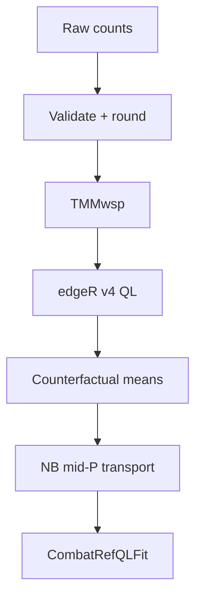

<div align="center">

# ComBat-refQL

<p><strong>QL-first reference-batch correction for raw RNA-seq counts</strong></p>

[](https://github.com/Thokas99/ComBat-refQL/actions/workflows/R-CMD-check.yaml)
[](https://thokas99.github.io/ComBat-refQL/)
[](NEWS.md)
[](#scientific-status)
[](https://www.r-project.org/)
[](https://bioconductor.org/packages/edgeR/)
[](LICENSE)

**Robust edgeR v4 quasi-likelihood fitting · counterfactual reference means · deterministic negative-binomial mid-P transport**

[Installation](#installation) · [Quick start](#quick-start) · [Method](#how-it-works) · [Diagnostics](#inspect-the-result) · [Limitations](#scientific-status)

</div>

---

> [!IMPORTANT]
> **ComBat-refQL is experimental.** It has deterministic implementation tests and a reproducible smoke simulation, but it has not passed broad simulation or external real-data validation. Do not describe it as production-ready or superior to established methods.

> [!CAUTION]
> Corrected counts do not propagate correction uncertainty. For differential-expression inference, analyse the **original raw counts** with an appropriate edgeR QL design containing batch and the biological variables of interest.

## What ComBat-refQL does

ComBat-refQL adjusts non-reference RNA-seq batches toward one chosen reference batch while preserving modelled biological groups and covariates.

| Property | Behaviour |
| --- | --- |
| Input | Raw counts, genes × samples |
| Normalization | TMMwsp |
| Model | Robust edgeR v4 QL GLM |
| Target | Explicit or automatically selected reference batch |
| Correction | Deterministic NB mid-P quantile transport |
| Biological structure | Group and supplied covariates preserved in counterfactual prediction |
| Output | Non-negative, integer-valued doubles with original dimensions and dimnames |
| Interface | One fitting function and validated S7 objects |

The public API is intentionally small:

```r
fit <- combat_ref_ql(...)

fit
summary(fit)
```

There is no baseline mode, legacy pathway, randomized mapping, plotting interface, or standalone command-line program.

## Workflow



The QL/NB boundary is deliberate:

- edgeR QL supplies fitted coefficients, observed means, counterfactual means, and moderated variability diagnostics;
- the underlying negative-binomial model supplies the valid CDF and quantile function used for count transport;
- posterior QL dispersion is **never** passed to `pnbinom()`, `dnbinom()`, or `qnbinom()`.

## Installation

Install the current development version from GitHub:

```r
install.packages("pak")
pak::pak("Thokas99/ComBat-refQL")
```

```r
library(combatrefql)
```

Requirements: R ≥ 4.3, edgeR ≥ 4.2, and S7 ≥ 0.2.0.

## Quick start

`counts` must be a numeric matrix with genes in rows and samples in columns. Row and column names must be present, unique, and non-missing.

```r
fit <- combat_ref_ql(
  counts = counts,
  batch = metadata$batch,
  group = metadata$condition,
  reference = "batch_A"
)
```

The reference can be selected automatically:

```r
fit <- combat_ref_ql(
  counts = counts,
  batch = metadata$batch,
  group = metadata$condition
)
```

An explicit reference is preferable when external QC or study design identifies the technically strongest batch.

### Add covariates

Covariates must contain one row per sample:

```r
fit <- combat_ref_ql(
  counts = counts,
  batch = metadata$batch,
  group = metadata$condition,
  covariates = metadata[c("sex", "age")],
  reference = "batch_A"
)
```

The batch, group, and covariate design must be full rank with positive residual degrees of freedom. Complete batch–biology confounding is rejected rather than guessed away.

### Pipeline-friendly execution

```r
fit <- combat_ref_ql(
  counts,
  batch = metadata$batch,
  group = metadata$condition,
  verbosity = "quiet"
)
```

| `verbosity` | Output |
| --- | --- |
| `"normal"` | Completed stages and interactive mapping progress |
| `"verbose"` | Stage details and durable non-interactive progress updates |
| `"quiet"` | Errors only |

## Input contract

### Accepted

- raw, non-negative count matrices;
- integer storage or integer-valued doubles;
- fractional estimated counts when audited rounding is appropriate;
- named batch and group vectors, reordered to match `colnames(counts)`;
- sample-aligned numeric or categorical covariates.

### Rejected

- TPM, CPM, logCPM, RPKM, FPKM, or other normalized expression matrices;
- negative, missing, or infinite values;
- duplicated or missing gene/sample identifiers;
- all-zero samples;
- batches with fewer than two samples;
- rank-deficient or completely confounded designs;
- unknown reference batches.

> [!NOTE]
> Input-scale detection is necessarily heuristic. Declaring an object to be raw counts does not make it so; verify its provenance before fitting.

### Fractional counts

Fractional values are rounded by default because estimated counts are common in RNA-seq workflows:

```r
fit <- combat_ref_ql(
  counts,
  batch,
  group,
  fractional_counts = "round"
)
```

The audit records affected values, affected genes, maximum absolute change, and total count change. Use strict rejection when rounding is inappropriate:

```r
fit <- combat_ref_ql(
  counts,
  batch,
  group,
  fractional_counts = "error"
)
```

## Inspect the result

`combat_ref_ql()` returns a validated S7 `CombatRefQLFit` object.

```r
fit
```

```text
── ComBat-refQL fit ─────────────────────────────────────────────

Data
  18,432 genes x 48 samples
  3 batches - 2 biological groups

Model
  QL GLM:         edgeR v4
  Normalization:  TMMwsp
  Transport:      negative-binomial mid-P
  Reference:      batch_A - explicitly selected

Result
  ✔ 17,904 adjusted
  ℹ 528 unchanged
  ✔ 0 failed

Runtime: 18.7 seconds
Use summary(x) for diagnostics.
```

### Main properties

```r
fit@counts
fit@specification
fit@samples
fit@gene_status
fit@diagnostics
fit@model
```

| Property | Contents |
| --- | --- |
| `fit@counts` | Adjusted count matrix |
| `fit@specification` | Method, normalization, reference, and chunk size |
| `fit@samples` | Batch, group, library sizes, and normalization factors |
| `fit@gene_status` | Per-gene status and unsupported-batch information |
| `fit@diagnostics` | Batch scores, mapping, timing, input actions, and QL summaries |
| `fit@model` | Compact coefficients, dispersions, and design information |

Extract adjusted counts explicitly:

```r
adjusted_counts <- fit@counts
```

### Detailed summary

```r
s <- summary(fit)
s
```

The summary is a validated `CombatRefQLSummary` object:

```r
s@overview
s@design
s@batches
s@gene_outcomes
s@ql
s@input_actions
s@warnings
s@timings
```

This keeps console output readable while leaving diagnostics available as tidy data frames.

<details>
<summary><strong>Inspect reference selection</strong></summary>

```r
summary(fit)@batches
```

```text
    batch samples reference_score selected               selection_method
1 batch_A      16           0.114     TRUE automatic_minimum_nb_dispersion
2 batch_B      16           0.139    FALSE automatic_minimum_nb_dispersion
3 batch_C      16           0.152    FALSE automatic_minimum_nb_dispersion
```

</details>

<details>
<summary><strong>Inspect rounded inputs</strong></summary>

```r
fit@diagnostics$input_actions
```

The table reports whether an action was lossy and how many values and genes it affected.

</details>

## How it works

For gene $g$ and sample $i$, ComBat-refQL fits

$$
\log(\mu_{gi}) = o_i + X_i\beta_g,
$$

where $o_i$ contains the effective-library-size offset and $X$ contains batch, biological-group, and supplied covariate terms.

Counterfactual prediction changes only the batch indicators:

$$
\widehat{\mu}^{\mathrm{ref}}_{gi}
=
\exp\!\left(o_i + X^{\mathrm{ref}}_i\widehat{\beta}_g\right).
$$

The biological group, covariates, and sample-specific offset remain unchanged.

For observed count $y$, deterministic mid-P transport calculates

$$
u = F_{\mathrm{obs}}(y-1)
    + \frac{1}{2}P_{\mathrm{obs}}(Y=y),
$$

then

$$
y^* = F^{-1}_{\mathrm{ref}}(u).
$$

Both distributions are negative binomial. Observed zeros remain zero in version 0.2.0.

See the [statistical methodology vignette](vignettes/statistical-methodology.Rmd) for the complete model and assumptions.

## Reference selection

When `reference = NULL`, every batch receives a within-batch QL fit with an intercept-only local design. The batch with the smallest valid underlying NB dispersion is selected.

> [!WARNING]
> Automatic selection is a convenience, not proof that a batch is an appropriate reference. Selection stability is not yet bootstrapped. Prefer an explicit reference supported by study design and external QC whenever possible.

## Performance

Transport uses gene chunks:

```r
fit <- combat_ref_ql(
  counts,
  batch,
  group,
  chunk_size = 5000L
)
```

Smaller chunks reduce temporary probability-mapping allocations but increase loop overhead. Larger chunks may be faster when memory is abundant.

An optional reproducible comparison with `sva::ComBat_seq()` is available in [`benchmark/`](benchmark/README.md). The recorded result is one local benchmark, not a general performance claim.

## Scientific status

### What is already tested

- S7 class construction and validation;
- input alignment and typed failures;
- edgeR v4 QL fitting with `legacy = FALSE`;
- separation of NB and QL dispersion quantities;
- deterministic mid-P transport and zero preservation;
- chunk-equivalent output;
- large integer-valued doubles;
- package installation and `R CMD check` on Linux and macOS.

### What remains unproven

- type-I error, FDR, and power;
- biological-signal preservation;
- sparse counts and strong composition shifts;
- automatic-reference stability;
- external real-data reproducibility;
- reliable peak-memory scaling;
- superiority over ComBat-seq or direct model-based alternatives.

The current smoke simulation changes the median batch B/A mean ratio from **1.7112** to **1.6667**. This is only modest movement toward one and must not be interpreted as broad validation.

### Current engineering priorities

1. **True memory-bounded mapping:** chunk fitted and counterfactual means as well as NB probability calculations.
2. **Per-gene mapping validation:** detect and report numerical mapping failures instead of assuming every supported gene succeeded.
3. **Stronger scale safety:** prevent normalized continuous matrices from being rounded into pseudo-counts.

See the [validation report](validation/VALIDATION_REPORT.md) for the exact evidence and limitations.

## Error handling

Failures use typed conditions with stage and context information:

```text
combatrefql_input_error
combatrefql_alignment_error
combatrefql_design_error
combatrefql_reference_error
combatrefql_ql_error
combatrefql_mapping_error
combatrefql_internal_error
```

This allows pipeline-level handling without parsing message text:

```r
tryCatch(
  combat_ref_ql(counts, batch, group, verbosity = "quiet"),
  combatrefql_design_error = function(error) {
    message("Design failed at stage: ", error$stage)
  }
)
```

## Documentation

| Resource | Purpose |
| --- | --- |
| [Statistical methodology](vignettes/statistical-methodology.Rmd) | Model, counterfactual design, and transport equations |
| [Implementation report](IMPLEMENTATION_REPORT.md) | Architecture and implementation decisions |
| [Validation report](validation/VALIDATION_REPORT.md) | Current evidence and validation gaps |
| [Benchmark](benchmark/README.md) | Optional runtime comparison |
| [Release notes](NEWS.md) | User-facing changes in 0.2.0 |
| [Changelog](CHANGELOG.md) | Repository development history |
| [Package website](https://thokas99.github.io/ComBat-refQL/) | Rendered reference documentation |

## Citation

```r
citation("combatrefql")
```

ComBat-refQL builds on the reference-batch concept described in:

> Zhang X. Highly effective batch effect correction method for RNA-seq count data. *Computational and Structural Biotechnology Journal*. 2025. [doi:10.1016/j.csbj.2024.12.010](https://doi.org/10.1016/j.csbj.2024.12.010) · [PMID: 39802213](https://pubmed.ncbi.nlm.nih.gov/39802213/)

## Contributing

Issues and focused pull requests are welcome. For statistical changes, include the estimand or failure mode, a reproducible simulation, invariants, runtime/memory consequences, and tests separating NB from QL dispersion roles.

Use the [issue tracker](https://github.com/Thokas99/ComBat-refQL/issues) for bug reports and proposals.

## License

The newly written ComBat-refQL implementation is available under the [MIT License](LICENSE). This does not invent or alter licensing terms for upstream publications, methods, software, or data.

---

<div align="center">

**ComBat-refQL 0.2.0** · focused QL modelling · auditable reference transport · explicit limitations

</div>
