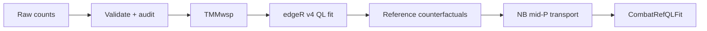

<div align="center">

# ComBat-refQL

<p><strong>QL-first reference-batch correction for raw RNA-seq counts</strong></p>

[](https://github.com/Thokas99/ComBat-refQL/actions/workflows/R-CMD-check.yaml)
[](https://thokas99.github.io/ComBat-refQL/)
[](NEWS.md)
[](#scientific-status)
[](https://www.r-project.org/)
[](https://bioconductor.org/packages/edgeR/)
[](LICENSE)

**Robust edgeR v4 QL fitting · counterfactual reference means · deterministic NB mid-P transport**

[Installation](#installation) · [Quick start](#quick-start) · [Method](#how-it-works) · [Diagnostics](#inspect-the-result) · [Scientific status](#scientific-status)

</div>

---

> [!IMPORTANT]
> **ComBat-refQL is experimental.** Its implementation is tested, but broad simulation and external real-data validation remain outstanding. It is not presented as production-ready or superior to established methods.

> [!CAUTION]
> Corrected counts do not propagate correction uncertainty. For differential-expression inference, analyse the **original raw counts** with batch and biological variables included in the edgeR QL design.

## What it does

ComBat-refQL adjusts non-reference RNA-seq batches toward one chosen reference batch while preserving modelled biological groups and covariates.

| Property | Behaviour |
| --- | --- |
| Input | Raw counts, genes × samples |
| Normalization | TMMwsp |
| Model | Robust edgeR v4 QL GLM |
| Reference | Explicit or automatically selected batch |
| Correction | Deterministic NB mid-P quantile transport |
| Output | Validated `CombatRefQLFit` S7 object |

The package exposes one fitting function, `combat_ref_ql()`. Baseline and legacy modes, randomized mapping, plotting, and a standalone CLI are absent.

## Workflow



## Installation

Install the development version from GitHub:

```r
install.packages("pak")
pak::pak("Thokas99/ComBat-refQL")

library(combatrefql)
```

Requirements: R ≥ 4.3, edgeR ≥ 4.2, and S7 ≥ 0.2.0.

## Quick start

```r
fit <- combat_ref_ql(
  counts = counts,
  batch = metadata$batch,
  group = metadata$condition,
  reference = "batch_A"
)

adjusted_counts <- fit@counts
```

Omit `reference` to select a batch automatically using biologically adjusted within-batch models:

```r
fit <- combat_ref_ql(counts, metadata$batch, metadata$condition)
```

An explicit reference is preferable when study design or external QC identifies
the technically strongest batch. Optional sample-aligned covariates can be
supplied with `covariates = metadata[c("sex", "age")]`.

Use `verbosity = "quiet"` in pipelines. The default reports completed stages
and real interactive progress; `"verbose"` adds durable progress updates in
non-interactive logs.

## Inspect the result

```r
fit
```

```text
── ComBat-refQL fit ─────────────────────────────────────────────

Data
  18,432 genes x 48 samples
  3 batches - 2 biological groups

Model
  QL GLM:         edgeR v4
  Normalization:  TMMwsp
  Transport:      negative-binomial mid-P
  Reference:      batch_A - explicitly selected

Result
  ✔ 17,904 adjusted
  ℹ 528 unchanged
  ✔ 0 failed

Runtime: 18.7 seconds
Use summary(x) for diagnostics.
```

The most useful S7 access points are:

```r
fit@counts
fit@gene_status
fit@diagnostics
summary(fit)
```

For automatic fits, `summary(fit)@batches` contains reference scores and
local-design diagnostics. Fit and summary printing remain compact and do not
replay progress messages.

## Input requirements

`counts` must be a numeric raw-count matrix with genes in rows and samples in columns. Row and column names must be unique and complete.

| Argument | Requirement |
| --- | --- |
| `counts` | Raw gene-by-sample counts with dimnames |
| `batch` | One observed batch label per sample |
| `group` | Optional biological group vector |
| `covariates` | Optional complete sample-by-covariate table |
| `reference` | Optional single observed batch label |

Accepted inputs include integer-valued counts and plausible fractional estimated counts. Fractional values are rounded by default and audited in `fit@diagnostics$input_actions`; use `fractional_counts = "error"` for strict rejection.

The package rejects:

- negative, missing, infinite, or all-zero sample values;
- suspicious normalized-expression matrices such as TPM, CPM, or log-expression;
- duplicated or missing gene/sample identifiers;
- batches with fewer than two samples;
- rank-deficient or completely confounded global designs;
- unknown explicit reference batches.

Input-scale detection is heuristic. Verify data provenance before fitting.

## How it works

ComBat-refQL performs three operations:

1. **Fit:** raw counts are TMMwsp-normalized and modelled with the robust edgeR v4 QL pipeline while preserving batch, biological group, and supplied covariates.
2. **Predict:** for each non-reference sample, only the batch indicators are replaced with those of the reference batch to obtain counterfactual expected counts.
3. **Transport:** observed counts are mapped toward those reference expectations with deterministic negative-binomial mid-P quantiles.

Automatic reference scoring uses fresh within-batch models that account for locally estimable biological groups and covariates.

QL fitting supplies the counterfactual means and variability diagnostics. The valid underlying negative-binomial dispersion supplies the CDF and quantile function; posterior QL dispersion is never used as an NB probability parameter.

See the [statistical methodology vignette](vignettes/statistical-methodology.Rmd) for equations and assumptions.

## Scientific status

ComBat-refQL is experimental. Its implementation is tested, but its statistical operating characteristics have not yet been established broadly.

Current limitations include:

- no broad simulation or external real-data validation;
- no bootstrap stability estimate for automatic reference selection;
- no propagation of correction uncertainty into downstream inference;
- genes without count support in every batch cannot be corrected.

For differential expression, use the original raw counts with batch included in the edgeR QL design.

See [Scientific status](SCIENTIFIC_STATUS.md) and the [validation report](validation/VALIDATION_REPORT.md).

## Documentation

| Resource | Purpose |
| --- | --- |
| [Statistical methodology](vignettes/statistical-methodology.Rmd) | Model, reference scoring, transport equations, and assumptions |
| [Scientific status](SCIENTIFIC_STATUS.md) | Uses, limitations, and validation still required |
| [Implementation report](IMPLEMENTATION_REPORT.md) | Architecture and implementation decisions |
| [Validation report](validation/VALIDATION_REPORT.md) | Current evidence and validation gaps |
| [Benchmark](benchmark/README.md) | Optional runtime comparison |
| [Release notes](NEWS.md) | User-facing changes |
| [Package website](https://thokas99.github.io/ComBat-refQL/) | Rendered reference documentation |

## Citation

```r
citation("combatrefql")
```

ComBat-refQL builds on the reference-batch concept described in:

> Zhang X. Highly effective batch effect correction method for RNA-seq count data. *Computational and Structural Biotechnology Journal*. 2025. [doi:10.1016/j.csbj.2024.12.010](https://doi.org/10.1016/j.csbj.2024.12.010) · [PMID: 39802213](https://pubmed.ncbi.nlm.nih.gov/39802213/)

## License

The newly written ComBat-refQL implementation is available under the [MIT License](LICENSE). This does not alter licensing terms for upstream publications, methods, software, or data.

---

<div align="center">

**ComBat-refQL 0.3.0** · focused QL modelling · auditable reference transport · explicit limitations

</div>
